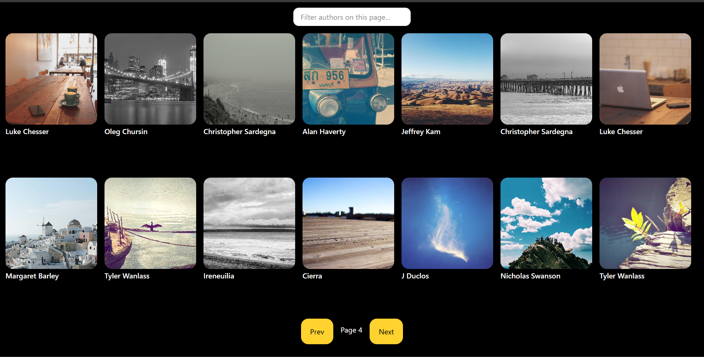

Photo Gallery

A paginated photo gallery built with React, pulling live images from the Picsum API. Includes author search/filtering within the current page.

**[Live Demo](https://react-gallery-app-wine.vercel.app/)**

**[Repo](https://github.com/prateekbuilds/React-Gallery-App)**

Features
🖼️ Live image gallery — fetches 14 images per page from the Picsum API
📄 Pagination — Prev/Next controls to browse through pages of images
🔍 Author search/filter — filters images by author name within the currently loaded page, case-insensitive
⏳ Loading, error, and empty states — clear feedback while fetching, on API failure, and when a search matches nothing
🔒 Secure external links — image links open in a new tab with rel="noopener noreferrer" to prevent tab-nabbing
🎨 Styled with Tailwind CSS
Tech Stack
React (Vite)
Tailwind CSS
Picsum Photos API
Deployed on Vercel
Architecture

State is managed with four pieces of useState:

daata — the current page's fetched images
index — the current page number
error — holds a user-facing message if the fetch fails
search — the current text in the search input

useEffect re-runs the fetch whenever index changes, so paging is driven entirely by state rather than manual event wiring. The component renders one of four states depending on what's currently true: loading, error, no search results, or the image grid — computed by filtering daata with .filter() before mapping it into cards.

A deliberate scoping decision

Search is scoped to filter only the currently loaded page's images, not all images across every page. Picsum's API has no server-side author search, so a true "global" search would require fetching every page upfront — expensive, slow, and a poor tradeoff for a feature this API was never designed to support. The search input is labeled accordingly ("Filter authors on this page...") so the scope is clear to the user rather than something they have to guess.

Known trade-offs
No request cancellation on rapid page changes. If Prev/Next is clicked in quick succession, overlapping fetches could theoretically resolve out of order. Left unaddressed for now — a proper fix would track a loading state and disable the buttons mid-fetch, or use an AbortController to cancel stale requests.
Running locally
Clone the repo
npm install
npm run dev

No API key required — Picsum's API is public.

What I'd add next
Disable Prev/Next while a fetch is in progress, to close the race-condition trade-off above
A "favorites" feature using localStorage
Skeleton loading cards instead of a single loading message